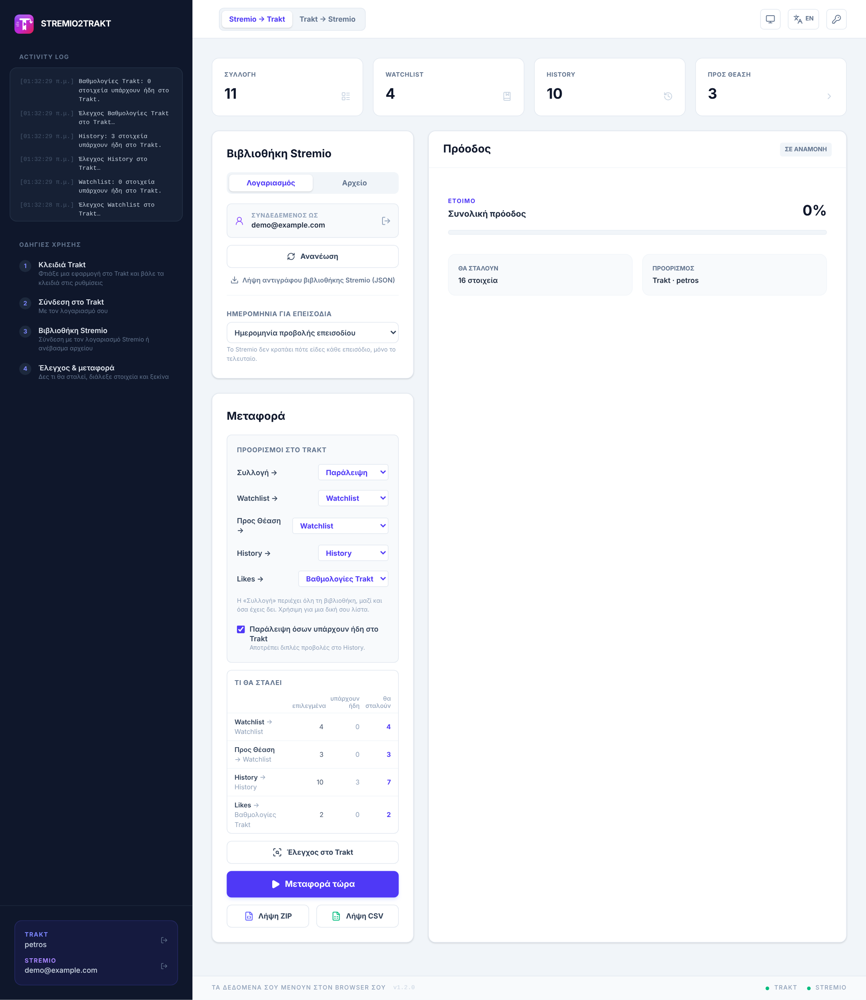
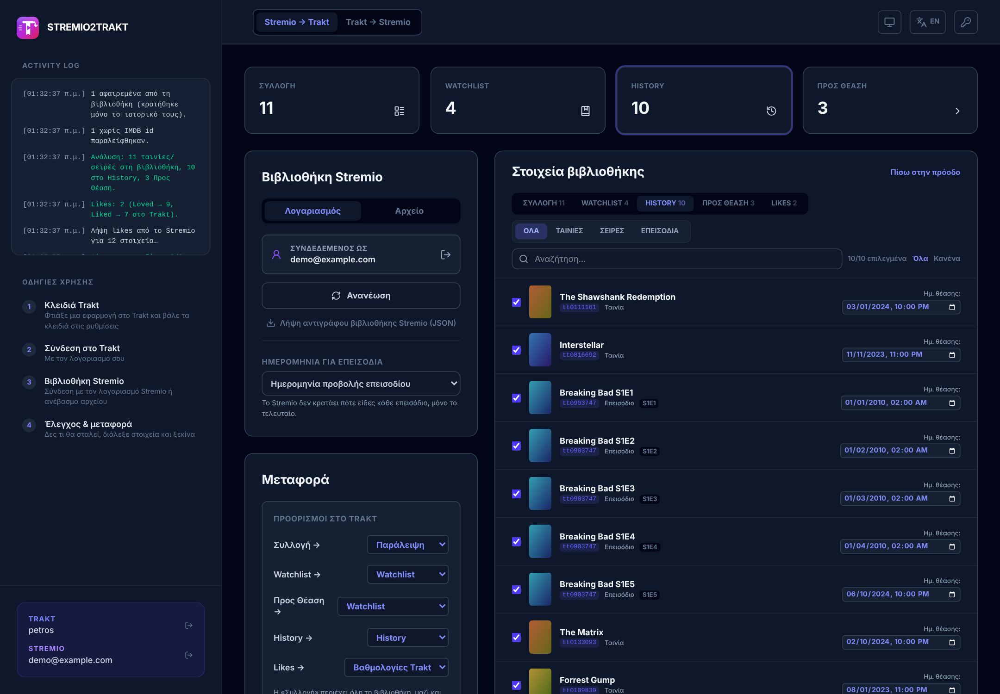
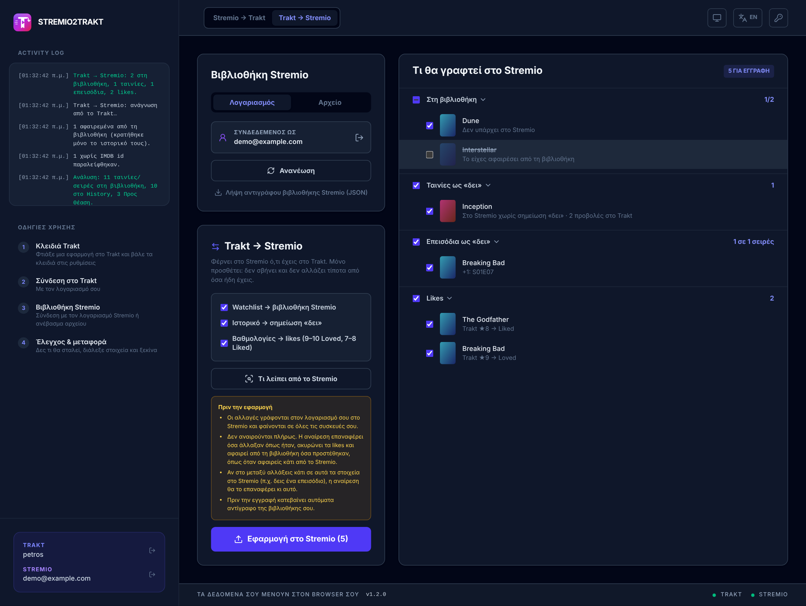
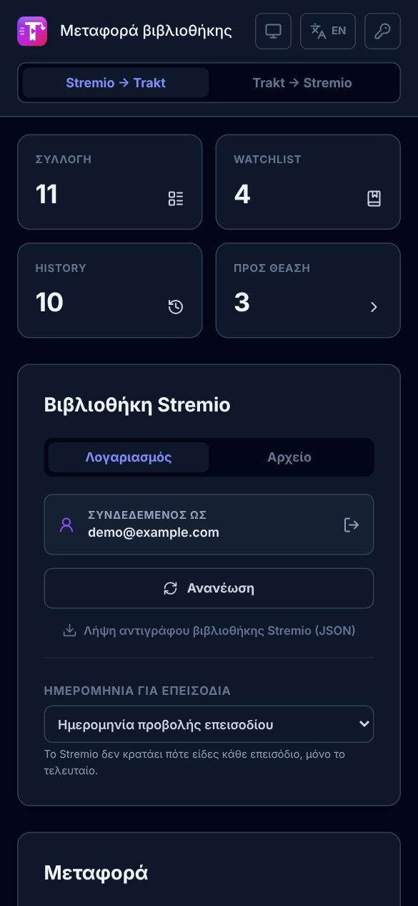

# Stremio to Trakt Migrator

Μεταφορά της βιβλιοθήκης σου από το **Stremio** στο **Trakt.tv** και αντίστροφα, απευθείας από τον browser.
*Move your Stremio library to Trakt.tv and back, right from your browser (Greek & English UI).*

[](https://github.com/petrosfs/Stremio-to-Trakt-Migrator/actions/workflows/deploy.yml)
[](https://github.com/petrosfs/Stremio-to-Trakt-Migrator/releases)

**▶ Άνοιξέ το:** https://petrosfs.github.io/Stremio-to-Trakt-Migrator/

<picture>
  <source media="(prefers-color-scheme: dark)" srcset="docs/screenshots/overview-dark.png">
  
</picture>

## Τι κάνει

- **Stremio → Trakt:** στέλνει στο Trakt ό,τι έχεις δει, τη λίστα σου, ό,τι έχεις ξεκινήσει και τα likes σου, χωρίς διπλές προβολές.
- **Trakt → Stremio:** φέρνει στο Stremio τη Watchlist, το ιστορικό και τις βαθμολογίες σου. Μόνο προσθέτει.

Δεν χρειάζεται εγκατάσταση ούτε server. Ανοίγεις τη σελίδα, συνδέεσαι και στις δύο πλευρές, ελέγχεις τι θα γίνει και πατάς ένα κουμπί.

## Δυνατότητες

### Stremio → Trakt

- **Σύνδεση με λογαριασμό Stremio:** με email και κωδικό, ή χωρίς κωδικό μέσω link.stremio.com (για λογαριασμούς Facebook, Google και Apple). Εναλλακτικά ανεβάζεις αρχείο JSON ή την αποθηκευμένη σελίδα της βιβλιοθήκης από το Stremio Web (.html).
- **Επεισόδια ένα-ένα:** το Stremio κρατά τα επεισόδια που έχεις δει σε κωδικοποιημένη μορφή. Η εφαρμογή τα αποκωδικοποιεί και στέλνει στο History κάθε επεισόδιο χωριστά. Τη λίστα επεισοδίων τη δίνει το Cinemeta.
- **Σωστές κατηγορίες:**
  - **Watchlist:** όσα είναι στη βιβλιοθήκη και δεν τα έχεις δει.
  - **History:** ταινίες και επεισόδια που έχεις δει.
  - **Προς Θέαση:** ό,τι έχεις ξεκινήσει, μαζί με το επεισόδιο που βλέπεις.
  - **Likes:** Loved → βαθμολογία 9, Liked → 7.

  Ό,τι έχεις αφαιρέσει από τη βιβλιοθήκη κρατά μόνο το ιστορικό του.
- **Προορισμοί:** κάθε κατηγορία πάει όπου διαλέξεις: Watchlist, History, δική σου λίστα, βαθμολογίες ή πουθενά.
- **Πρόοδος στο Trakt:** τα «Προς Θέαση» μπορούν να συνεχίσουν στο Trakt από το σημείο που σταμάτησες (έως 79%).
- **Χωρίς διπλές προβολές:** πριν την αποστολή διαβάζει τι υπάρχει ήδη στο Trakt και το παραλείπει. Ο πίνακας «Τι θα σταλεί» δείχνει τι θα γίνει πριν γίνει.
- **Πολλές προβολές της ίδιας ταινίας:** πάνε όλες στο History.
- **Μόνο τα νέα:** στέλνει μόνο ό,τι άλλαξε από την τελευταία μεταφορά.
- **Επιλογή ανά στοιχείο:** αναζήτηση, φίλτρο ταινίες/σειρές/επεισόδια, εξώφυλλα και διόρθωση της ημερομηνίας θέασης.
- **Αναίρεση:** αφαιρεί από το Trakt ό,τι πρόσθεσε η τελευταία μεταφορά.
- **Εξαγωγή:** CSV ή ZIP (JSON + CSV).



### Trakt → Stremio

Ξεχωριστή καρτέλα στην πάνω μπάρα.

- **Watchlist → βιβλιοθήκη Stremio.**
- **Ιστορικό → σημείωση «δει»:** για ταινίες, και για σειρές ανά επεισόδιο, χωρίς να χαθούν όσα έχεις ήδη σημειώσει στο Stremio.
- **Βαθμολογίες → likes:** 9–10 → Loved, 7–8 → Liked. Like που έχεις ήδη στο Stremio δεν αλλάζει.
- **Προεπισκόπηση:** κάθε τίτλος εμφανίζεται με την αιτία που είναι στη λίστα, π.χ. «Δεν υπάρχει στο Stremio», «Το είχες αφαιρέσει από τη βιβλιοθήκη», «Μόνο στο Continue Watching», τα νέα επεισόδια ή τη βαθμολογία του Trakt. Όποιον δεν θέλεις τον ξετσεκάρεις.
- **Ασφάλεια:** πριν από κάθε εγγραφή κατεβαίνει αυτόματα αντίγραφο της βιβλιοθήκης σου. Μετά υπάρχει αναίρεση.



### Γενικά

- Ελληνικά και English, φωτεινό και σκοτεινό θέμα.
- PWA: εγκαθίσταται στο κινητό σαν εφαρμογή.
- Αντίγραφο της βιβλιοθήκης Stremio (JSON) με ένα κλικ.



## Πώς το χρησιμοποιείς

1. **Κλειδιά Trakt:** φτιάξε μια εφαρμογή στο Trakt και βάλε το Client ID στις ρυθμίσεις (εικονίδιο κλειδιού). Οδηγίες [παρακάτω](#κλειδιά-trakt).
2. **Σύνδεση στο Trakt:** πάτα «Σύνδεση Trakt» και γράψε τον κωδικό που εμφανίζεται στη σελίδα του Trakt.
3. **Σύνδεση στο Stremio:** με λογαριασμό ή ανεβάζοντας αρχείο. Για την κατεύθυνση Trakt → Stremio χρειάζεται λογαριασμός.
4. **Stremio → Trakt:** διάλεξε προορισμούς, πάτα «Έλεγχος στο Trakt», δες τι θα σταλεί και πάτα «Μεταφορά τώρα».
5. **Trakt → Stremio:** άλλαξε καρτέλα, πάτα «Τι λείπει από το Stremio», δες τους τίτλους και πάτα «Εφαρμογή στο Stremio».

## Τι πάει πού

| Stremio | Trakt (προεπιλογή) |
| --- | --- |
| Στη βιβλιοθήκη, δεν το έχεις δει | Watchlist |
| Ταινίες και επεισόδια που έχεις δει | History, με ημερομηνία |
| Ξεκινημένα («Continue Watching») | Watchlist ή πρόοδος Trakt |
| Loved / Liked | Βαθμολογία 9 / 7 |
| Όλη η βιβλιοθήκη («Συλλογή») | Παράλειψη (ή δική σου λίστα) |

| Trakt | Stremio |
| --- | --- |
| Watchlist | Βιβλιοθήκη |
| History (ταινίες, επεισόδια) | Σημείωση «δει» |
| Βαθμολογία 9–10 / 7–8 | Loved / Liked |

## Καλό να ξέρεις

- **Ημερομηνίες επεισοδίων:** το Stremio κρατά μόνο πότε είδες το τελευταίο επεισόδιο μιας σειράς. Για τα υπόλοιπα διαλέγεις ημερομηνία: την ημερομηνία προβολής του επεισοδίου, την τελευταία θέαση της σειράς ή την ώρα της μεταφοράς.
- **Πολλές προβολές ταινίας:** το Stremio μετρά πόσες φορές είδες μια ταινία, αλλά κρατά μόνο την ημερομηνία της τελευταίας. Οι προηγούμενες προβολές μπαίνουν στην ημερομηνία κυκλοφορίας.
- **Χωρίς IMDB id:** στοιχεία όπως anime από το Kitsu δεν αναγνωρίζονται από το Trakt και παραλείπονται. Το log γράφει πόσα.
- **Αναίρεση στο Stremio:** επαναφέρει όσα άλλαξαν όπως ήταν και ακυρώνει τα likes. Ό,τι προστέθηκε αφαιρείται από τη βιβλιοθήκη, όπως όταν αφαιρείς κάτι από το ίδιο το Stremio. Αν στο μεταξύ αλλάξεις κάτι σε αυτά τα στοιχεία, η αναίρεση θα το επαναφέρει κι αυτό.
- **Ιδιωτικότητα:** όλα τρέχουν στον browser σου. Τα δεδομένα στέλνονται μόνο στο Stremio, στο Cinemeta και στο Trakt. Ο κωδικός του Stremio δεν αποθηκεύεται. Τα κλειδιά και οι συνδέσεις μένουν μόνο σε αυτόν τον browser.

## Κλειδιά Trakt

Η σύνδεση γίνεται με δική σου εφαρμογή στο Trakt. Χρειάζεται μόνο το **Client ID**:

1. Άνοιξε το https://app.trakt.tv/settings/apps και φτιάξε νέα εφαρμογή.
2. **Redirect URI:** η διεύθυνση του site, `https://petrosfs.github.io/Stremio-to-Trakt-Migrator/`
3. **Javascript (CORS) origins:** `https://petrosfs.github.io`
4. Βάλε το **Client ID** στις ρυθμίσεις της εφαρμογής (εικονίδιο κλειδιού).

Οι νέες εφαρμογές του Trakt δεν έχουν Client Secret. Αν η δική σου έχει, μπορείς να το συμπληρώσεις προαιρετικά.

## Ανάπτυξη

Χρειάζεται Node.js 20 ή νεότερο.

```bash
npm install
npm run dev          # τοπικός server
npm test             # unit tests (Vitest)
npm run build
npm run test:e2e     # end-to-end tests (Playwright, με mock APIs)
npm run screenshots  # ξαναβγάζει τα screenshots του README (docs/screenshots)
```

Για τα e2e tests και τα screenshots χρειάζεται πρώτα `npx playwright install chromium` και `npm run build`. Τα screenshots βγαίνουν με δοκιμαστικά δεδομένα.

Κάθε push στο `main` τρέχει όλα τα tests και, αν περάσουν, δημοσιεύει στο GitHub Pages.

### Δομή

| Αρχείο | Τι κάνει |
| --- | --- |
| `src/lib/stremio.ts` | API του Stremio (σύνδεση, βιβλιοθήκη, likes), Cinemeta, κατάταξη σε κατηγορίες |
| `src/lib/bitfield.ts` | Αποκωδικοποίηση και κωδικοποίηση των επεισοδίων που έχεις δει (`state.watched`) |
| `src/lib/trakt.ts` | Σύνδεση στο Trakt (device code), αιτήματα με σελιδοποίηση και επανάληψη |
| `src/lib/sync.ts` | Stremio → Trakt: τι υπάρχει ήδη, αποστολή, πρόοδος, αναίρεση |
| `src/lib/reverse.ts` | Trakt → Stremio: σχέδιο αλλαγών με αιτίες, αναίρεση |
| `src/lib/parse.ts`, `export.ts` | Ανάγνωση αρχείων, εξαγωγή CSV/ZIP |
| `src/i18n.tsx` | Ελληνικά και English |

Οι αλλαγές κάθε έκδοσης είναι στο [CHANGELOG](CHANGELOG.md).

## Τεχνολογίες

React 19 · TypeScript · Vite · Tailwind CSS · fflate · Vitest · Playwright · Trakt API v2 · Stremio API · Cinemeta
